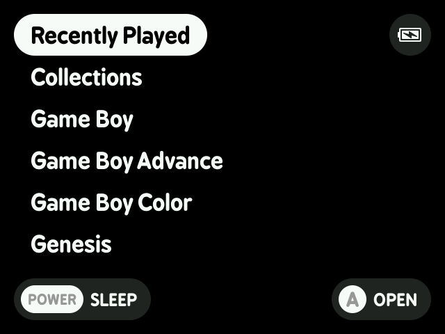
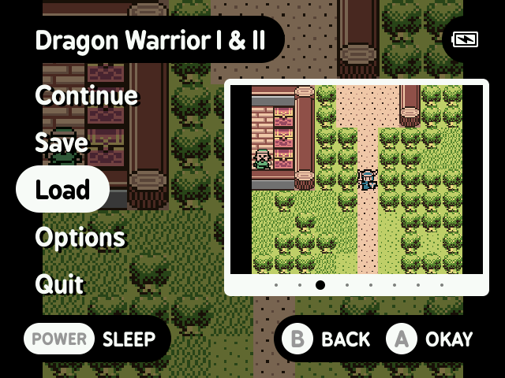

# Cannelloni

Cannelloni is a focused, custom launcher and libretro frontend for [a variety of retro handhelds](#supported-devices), forked and rebranded from [MinUI](https://github.com/shauninman/MinUI).

  

## Features

- Simple launcher, simple SD card
- Default #f1c40f Gold accent color with customizable themes
- Nonna's Kitchen wireless FTP file transfer solution
- Interactive settings menu with Wi-Fi status and configuration
- No boxart, themes, or distractions
- Automatically hides hidden files
  and extension and region/version 
  cruft in display names
- Consistent in-emulator menu with
  quick access to save states, disc
  changing, and emulator options
- Automatically sleeps after 30 seconds 
  or press POWER to sleep (and wake)
- Automatically powers off while asleep
  after two minutes or hold POWER for
  one second
- Automatically resumes right where
  you left off if powered off while
  in-game, manually or while asleep
- Resume from manually created, last 
  used save state by pressing X in 
  the launcher instead of A
- Streamlined emulator frontend 
  (minarch + libretro cores)
- Single SD card compatible with
  multiple devices from different
  manufacturers

> Devices with a physical power switch
> use MENU to sleep and wake instead of
> POWER. Once asleep the device can safely
> be powered off manually with the switch.

## Supported consoles

Base:

- Game Boy
- Game Boy Color
- Game Boy Advance
- Nintendo Entertainment System
- Super Nintendo Entertainment System
- Nintendo DS (melonDS)
- Sega Genesis
- PlayStation

Extras:

- Neo Geo Pocket (and Color)
- Pico-8
- Pokémon mini
- Sega Game Gear
- Sega Master System
- Super Game Boy
- TurboGrafx-16 (and TurboGrafx-CD)
- Virtual Boy

## Supported Devices

| Device | Added | Status |
| -- | -- | -- |
| Anbernic RG28xx | Cannelloni-20240429b-2 | Legacy |
| Anbernic RG34xx | Cannelloni-20241227-0 | Legacy |
| Anbernic RG34xxSP | Cannelloni-20250920-0 | Legacy |
| Anbernic RG35xx | Cannelloni-20230922b-2 | Legacy |
| Anbernic RG35xx Plus | Cannelloni-20240106b-0 | Legacy |
| Anbernic RG35xxH | Cannelloni-20240120b-1 | Legacy |
| Anbernic RG35xxSP | Cannelloni-20240525-0 | Legacy |
| Anbernic RG40xxH | Cannelloni-20240717-1 | Legacy |
| Anbernic RG40xxV | Cannelloni-20240831-0 | Legacy | 
| Anbernic RG CubeXX | Cannelloni-202401028-0 | Legacy | 
| GKD Pixel | Cannelloni-20240120b-1 | Legacy |
| M17 | Cannelloni-20231126b-2 | Legacy |
| MagicX XU Mini M | Cannelloni-20240831-0 | Legacy | 
| MagicX Mini Zero 28 | Cannelloni-20250111-0 | Legacy |
| Miyoo A30 | Cannelloni-20240705-0 | Legacy |
| Miyoo Flip | Cannelloni-20250111-0 | Legacy |
| Miyoo Mini | Cannelloni-20230922b-2 | Legacy |
| Miyoo Mini Flip | Cannelloni-20251023-0 | Legacy |
| Miyoo Mini Plus | Cannelloni-20230922b-2 | Legacy |
| Powkiddy RGB30 | Cannelloni-20231014b-1 | Legacy |
| Trimui Brick | Cannelloni-20241028-0 | Legacy |
| Trimui Smart | Cannelloni-20230922b-2 | Legacy |
| Trimui Smart Pro | Cannelloni-20231111b-2 | Legacy |

> [!NOTE]
> **Active** actively working on compatibility and improvements specific to this device  
> **Maintained** inheriting improvements to common functionality  
> **Legacy** will be retired in a future update  
> **Retired** removed from repo, no longer updated or packaged with new releases

## Legacy versions

The original Trimui Model S version of MinUI (2021/04/03-2021/08/06) has been archived [here](https://github.com/shauninman/MinUI-Legacy-Trimui-Model-S).

The sequel, MiniUI for the Miyoo Mini (2022/04/20-2022/10/23), has been archived [here](https://github.com/shauninman/MiniUI-Legacy-Miyoo-Mini).

The return of MinUI for the original Anbernic RG35XX (2023/02/26-2023/03/26) has been archived [here](https://github.com/shauninman/MinUI-Legacy-RG35XX).

The multi-device version of MinUI (now forked as Cannelloni) which introduced support for multiple devices starting with the Trimui Smart, Miyoo Mini (and Plus), and the original Anbernic RG35XX was released on [2023/09/22][init-release] with the initial functional commit 6 months earlier on [2023/03/27][init-commit].

[init-release]:https://github.com/shauninman/MinUI/releases/tag/v20230922b-2
[init-commit]:https://github.com/shauninman/MinUI/commit/53e0296ea5a2794290fb5783765af6cee0063445#diff-b993e61ab6e66a19b67c88cfb98261aa9267d250de8bb56463662f67aae1a558