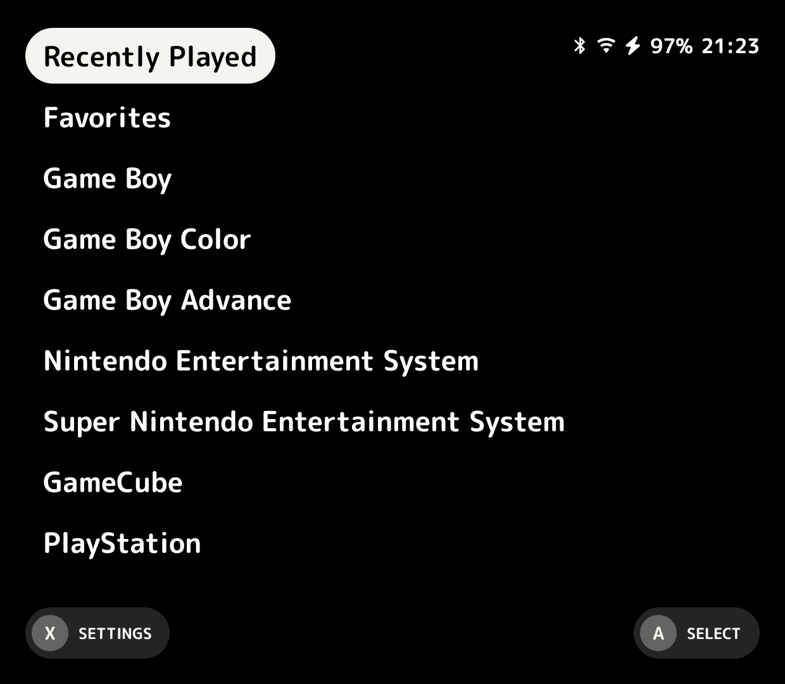
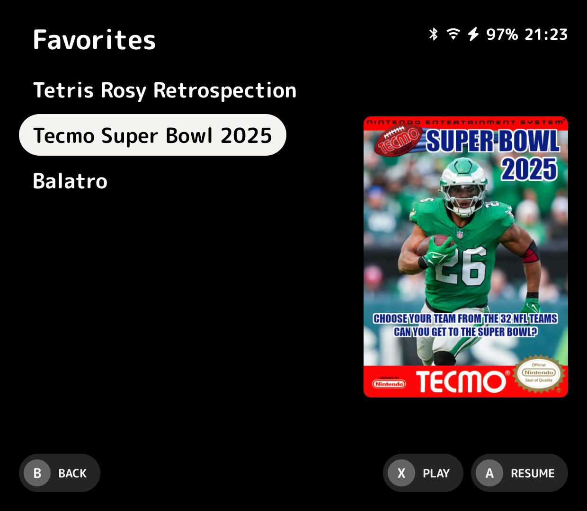
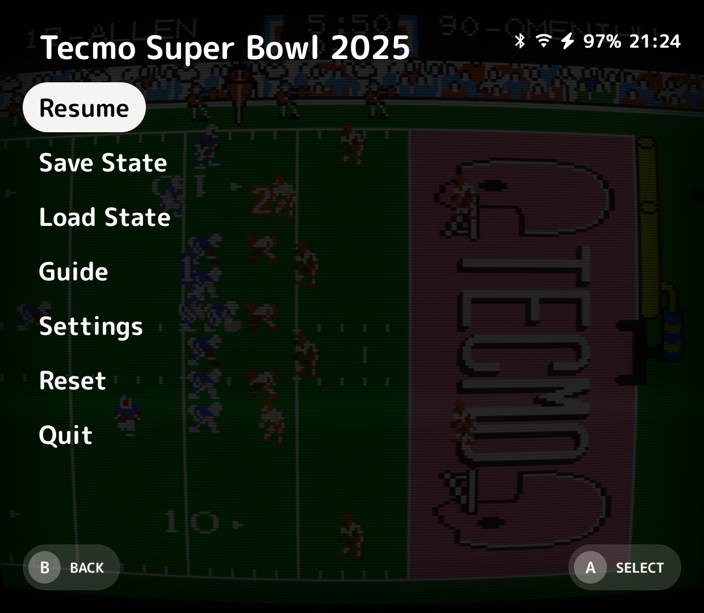

<div align="center">


<p align="center">
  <strong>The universal, distraction-free retro gaming frontend for Linux handhelds.</strong><br>
  Built on the shoulders of <a href="https://github.com/CannoliHQ/cannoli">Cannoli</a> and inspired by <a href="https://github.com/shauninman/MinUI">MinUI</a>.
</p>

<p align="center">
  <a href="LICENSE"></a>
  <a href="https://github.com/Denarmo/cannelloni-linux/releases"></a>
  <a href="LEGAL.md"></a>
  <a href="#-supported-devices"></a>
  <a href="https://ko-fi.com/denarmo"></a>
  <a href="https://discord.com"></a>
</p>

</div>

---

## 🍝 What is Cannelloni?

**Cannelloni** is a modern, opinionated, and lightweight retro gaming launcher and libretro frontend designed specifically for Linux handheld gaming devices.

Most modern handheld firmwares and frontends suffer from feature bloat: complex scrapers that fail on large collections, labyrinthine nested settings, laggy user interfaces, sluggish boot times, and endless tweaking required before you can even launch a game.

Cannelloni takes the opposite path:
- **Instant launch:** Turn your device on and be playing within seconds.
- **Clean aesthetic:** Beautiful, distraction-free typography and iconography that puts your game library front and center, accented with Cannelloni Gold.
- **Zero-fuss execution:** Drop your ROMs into organized folders and play immediately—no scraping, no metadata synchronization wait times, and no configuration headaches.
- **Consistent In-Game Experience:** A unified In-Game Menu (IGM) across all native cores for instant save states, disc switching, screen scaling, button remapping, and battery indicators.
- **One SD Card Across All Devices:** Pop your SD card out of an Anbernic and insert it into a Miyoo or TrimUI—your saves, states, and settings just work seamlessly.

---

## 🚀 Handheld Experience & Features

### 🍳 Nonna's Kitchen (Wireless FTP File Transfer)
- Transfer ROMs, BIOS files, saves, and save states wirelessly over Wi-Fi on supported devices without removing your SD card.
- Built-in lightweight FTP server running on port 2121.
- Simple toggle directly in the Settings menu (press `MENU` in the launcher) or launch as a standalone tool.
- Full compatibility with any standard FTP client (FileZilla, Cyberduck, WinSCP, or native mobile and desktop file managers).

### ⚡ Built-in Nintendo DS (melonDS) Core Integration
- Zero-configuration Nintendo DS emulation directly integrated with Cannelloni's launcher and In-Game Menu.
- Fast, accurate DS emulation without requiring external standalone emulators.
- Seamless save states, screen layout customization, and instant auto-resume support.

### 🎨 Cannelloni Gold Accent UI
- Refined, signature Cannelloni Gold accent color applied dynamically across menu selector pills, volume bars, brightness bars, and battery levels.
- Built-in color preset switcher in the Settings menu (Gold, Cannoli Blue, Coral Red, Emerald, Purple, Amber, White).
- Distraction-free typography with custom crisp fonts scaled perfectly for handheld screens.

### ⚙️ Interactive Settings Menu & Wi-Fi Management
- Unified Settings menu opened with a single press of `MENU` in the launcher.
- Live Wi-Fi connection status, IP address display, and network controls for wireless-capable handhelds.
- Device hardware specifications, release versions, and storage monitoring.

### 💾 Quicksave, Sleep & Auto-Resume
- Seamless state preservation: simply tap the power button to sleep, or power down anytime.
- Cannelloni automatically saves your exact progress and resumes instantly next time you power on.

---

## 📸 Screenshots

<p align="center">
  
  
  
</p>

---

## 🕹️ Supported Systems & Cores

Cannelloni includes optimized Libretro cores for immediate, zero-configuration playback:

| System | System Folder | Core / Engine | License |
| :--- | :--- | :--- | :--- |
| **Sony PlayStation** | `PS` | PCSX ReARMed | GPLv2 |
| **Super Nintendo (SNES)** | `SFC` | Snes9x | Non-commercial |
| **Nintendo Entertainment System (NES)** | `FC` | Nestopia | GPLv2 |
| **Game Boy / Game Boy Color** | `GB` / `GBC` | Gambatte | GPLv2 |
| **Game Boy Advance** | `GBA` | mGBA | MPLv2.0 |
| **Sega Genesis / Mega Drive** | `MD` | Genesis Plus GX | Non-commercial |
| **Sega Master System / Game Gear** | `SMS` / `GG` | Genesis Plus GX | Non-commercial |
| **Arcade / Neo Geo** | `ARCADE` / `NEOGEO` | FBNeo / MAME 2003-Plus | Non-commercial / MAME |
| **PC Engine / TurboGrafx-16** | `PCE` | Mednafen PCE FAST | GPLv2 |
| **Atari 2600 / 7800** | `A2600` / `A7800` | Stella / ProSystem | GPLv2 |
| **Atari Lynx** | `LYNX` | Handy | Zlib |
| **Neo Geo Pocket / Color** | `NGP` / `NGPC` | Mednafen NGP | GPLv2 |
| **WonderSwan / Color** | `WS` / `WSC` | Mednafen WonderSwan | GPLv2 |
| **Virtual Boy** | `VB` | Mednafen VB | GPLv2 |
| **Nintendo DS (NDS)** | `NDS` | melonDS | GPLv3 |
| **Pokémon Mini** | `PKMN` | PokeMini | GPLv3 |

---

## 📁 Directory Structure & Setup

Place your retro gaming collection on your SD card structured as follows:

```text
/sdcard/
├── Bios/
│   ├── FC/                 (disksys.rom)
│   ├── GB/                 (gb_bios.bin)
│   ├── GBA/                (gba_bios.bin)
│   ├── GBC/                (gbc_bios.bin)
│   ├── MD/                 (bios_CD_E.bin, bios_CD_J.bin, bios_CD_U.bin)
│   ├── NDS/                (bios7.bin, bios9.bin, firmware.bin)
│   ├── PS/                 (psxonpsp660.bin)
│   └── ...
├── Cannelloni/              (Cannelloni core system files)
├── Collections/            (Custom text-based playlists)
├── Roms/
│   ├── FC/                 (NES / Famicom games)
│   ├── SFC/                (SNES / Super Famicom games)
│   ├── GBA/                (Game Boy Advance games)
│   ├── NDS/                (Nintendo DS .nds / .dsi games)
│   ├── PS/                 (PlayStation .chd / .cue / .m3u)
│   └── ...
├── Saves/                  (In-game battery saves)
└── .userdata/              (Shared settings, Wi-Fi profiles, and quicksave states)
```

### Installation
1. Download the latest `Cannelloni-*-base.zip` (and optional `extras.zip`) from [GitHub Releases](https://github.com/Denarmo/cannelloni-linux/releases).
2. Extract the device-specific boot files for your handheld to your SD card along with `Cannelloni.zip` (without unzipping `Cannelloni.zip`).
3. Power on your device and Cannelloni will self-install and launch automatically.

---

## 📱 Supported Devices

| Device Family | Models | Installation Directory / File |
| :--- | :--- | :--- |
| **Anbernic H700** | RG35XX Plus, RG35XX H, RG35XX 2024, RG28XX, RG35XX SP, RG40XX H, RG40XX V, RG CubeXX, RG34XX, RG34XX SP | `/rg35xxplus/dmenu.bin` on TF1, `Cannelloni.zip` on TF2 |
| **Anbernic Actions** | RG35XX (original) | `/rg35xx/dmenu.bin` on TF1, `Cannelloni.zip` on TF2 |
| **Miyoo Mini Series** | Miyoo Mini, Miyoo A30 | `/miyoo/` folder and `Cannelloni.zip` on root |
| **Miyoo Mini Plus** | Miyoo Mini Plus | `/miyoo354/` folder and `Cannelloni.zip` on root |
| **Miyoo Clamshells** | Miyoo Flip, Miyoo Mini Flip | `/miyoo355/` or `/miyoo285/` folder and `Cannelloni.zip` on root |
| **TrimUI Handhelds** | TrimUI Model S / Smart, TrimUI Smart Pro, TrimUI Brick | `/trimui/` folder and `Cannelloni.zip` on root |
| **Powkiddy Handhelds**| Powkiddy RGB30 | `/rgb30/` folder and `Cannelloni.zip` on root |
| **MagicX Handhelds** | MagicX XU Mini M, MagicX Mini Zero 28 | `/magicxmini/` folder and `Cannelloni.zip` on root |
| **GKD Handhelds** | GKD Pixel, GKD Mini | `/gkdpixel/` folder and `Cannelloni.zip` on root |
| **M17 Handhelds** | M17 | `em_ui.sh` and `Cannelloni.zip` on root |

---

## ⚖️ Legal Information & Anti-Piracy Policy

Cannelloni takes intellectual property and copyright law seriously. Please review our comprehensive [**LEGAL.md**](LEGAL.md) document for complete terms.

### 1. Non-Affiliation and Trademarks
Cannelloni is an independent, community-driven open-source project and is **not affiliated with, authorized, endorsed, sponsored, or in any way associated with Nintendo, Sony, Sega, Microsoft, Atari, SNK, Bandai Namco, or any other entity**. All trademarks, system names, product names, logos, and brands are the property of their respective trademark holders and are used solely for descriptive, nominative identification under Fair Use principles.

### 2. Absolute Anti-Piracy Policy — No ROMs or BIOS Distributed
- **Cannelloni does NOT contain, distribute, host, share, or provide any copyrighted game ROMs, disk images, ISOs, BIOS files, firmware, decryption keys, or proprietary software.**
- Users are solely responsible for obtaining their own legitimate software and BIOS files dumped legally from hardware and physical media that they legally own.
- The project maintainers have a strict zero-tolerance policy against software piracy. Inquiries regarding where to find or download illegal ROMs or BIOS files will be summarily rejected and banned.

### 3. Emulation Legality
Cannelloni is purely an open-source graphical user interface (frontend), launcher, and media player. Emulation and clean-room reverse engineering for interoperability have been repeatedly recognized as lawful fair use under established United States federal court precedent (*Sony Computer Entertainment v. Connectix Corp.*, 203 F.3d 596; *Sega Enterprises Ltd. v. Accolade, Inc.*, 977 F.2d 1510).

### 4. DMCA Compliance
Cannelloni complies with the Digital Millennium Copyright Act (17 U.S.C. § 512). If you believe that content hosted directly within this repository infringes upon your copyright, please consult [**LEGAL.md**](LEGAL.md) for the formal notice and takedown procedure.

---

## 💖 Credits & Acknowledgments

Cannelloni is built upon the collective work of incredible developers and artists in the retro gaming and open-source communities:

- **[Shaun Inman](https://github.com/shauninman)**: Creator of [MinUI](https://github.com/shauninman/MinUI), whose vision of distraction-free, minimalist handheld gaming inspired this entire journey.
- **[Cannoli](https://github.com/CannoliHQ/cannoli)**: The Android MinUI frontend developed by the Cannoli team, inspiring the expanded vision of Cannelloni.
- **[Libretro / RetroArch](https://www.libretro.com)**: For the extraordinary cross-platform Libretro API and the vibrant emulator core ecosystem.
- **Emulation Core Teams**: The dedicated developers of melonDS (melonDS Team & Arisotura), PCSX ReARMed, Snes9x, Nestopia, Gambatte, mGBA, Genesis Plus GX, FBNeo, MAME 2003-Plus, Mednafen, Stella, ProSystem, Handy, and PokeMini.
- **Handheld Contributors & Hackers**: Special thanks to eggs, neonloop, adixial, acmeplus, muOS, Knulli, fewt, JELOS, Steward, Gamma, BlackSeraph, and Jim Gray for their tireless work across device kernels, toolchains, and hardware bringup.

For an itemized list of licenses and attributions, see [credits.json](credits.json) and [LICENSE](LICENSE).

---

## ☕ Support & 💬 Contact

- **Support on Ko-fi:** If you enjoy Cannelloni and want to support ongoing development, consider buying me a coffee on **[Ko-fi (ko-fi.com/denarmo)](https://ko-fi.com/denarmo)**.
- **Discord:** For questions, feedback, or general contact, reach out directly on Discord at **`@denarmo`**.

---

## 📄 License

Cannelloni is distributed as free, open-source software under the terms of the **[GNU General Public License v3.0 (GPL-3.0)](LICENSE)**.