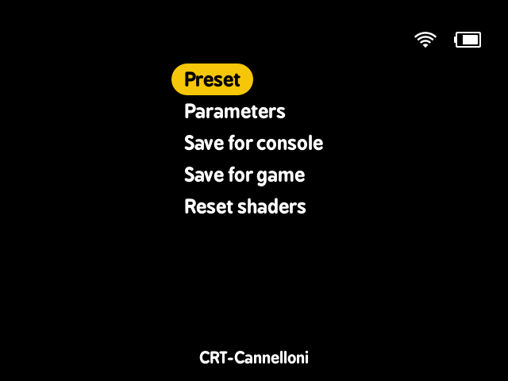
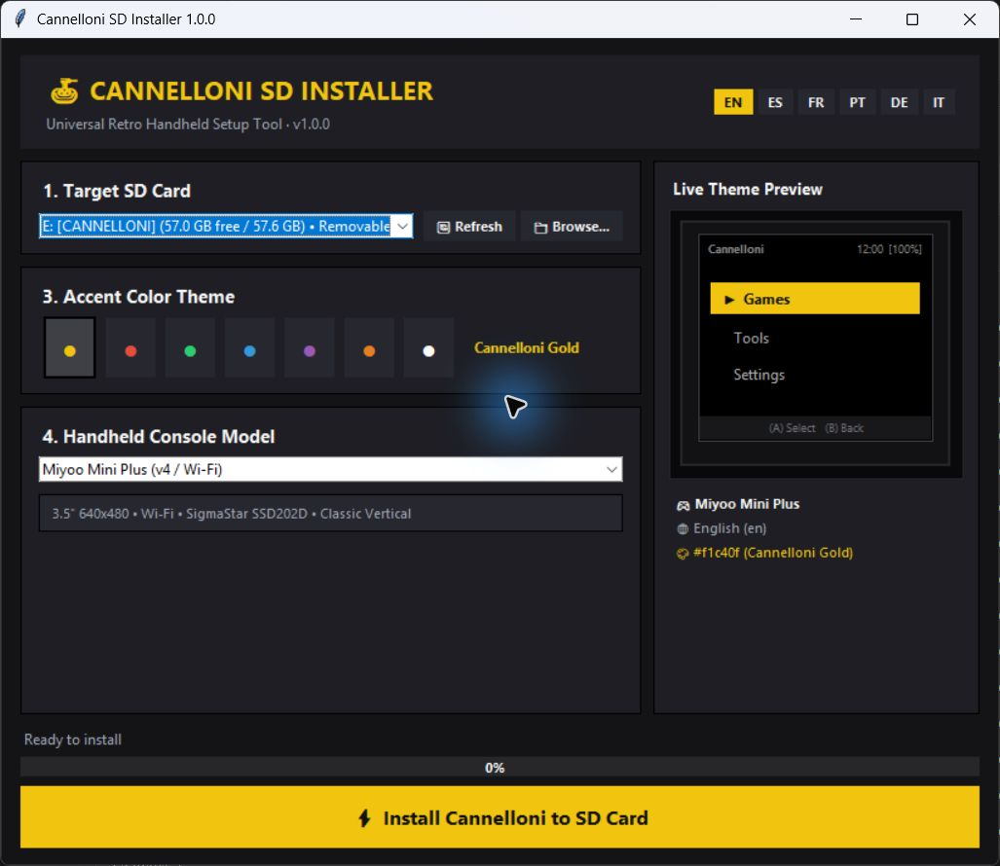
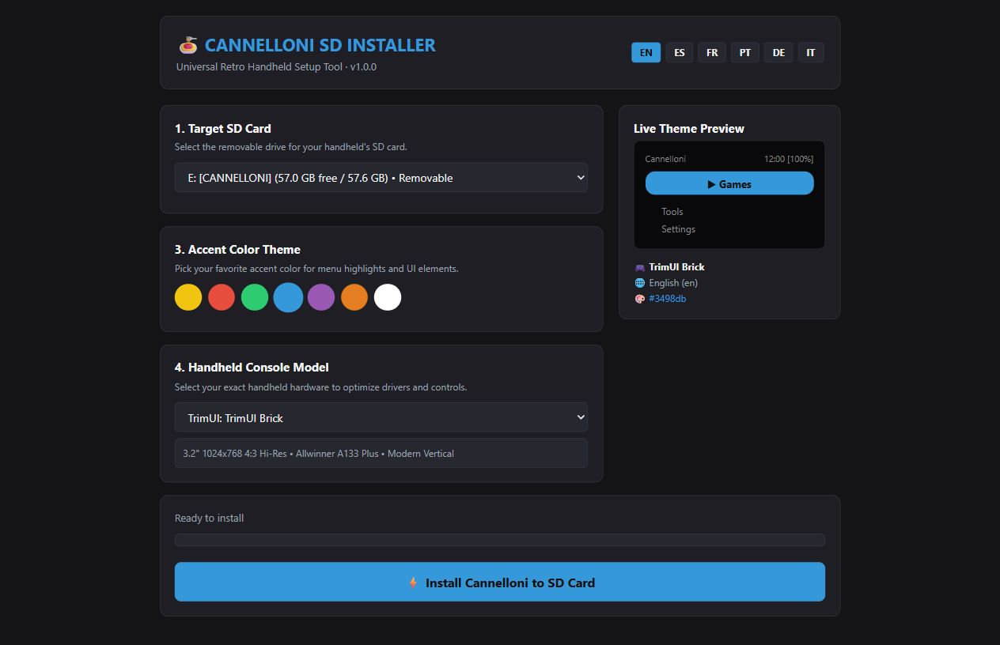
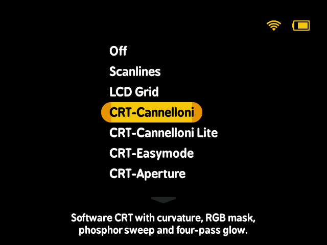
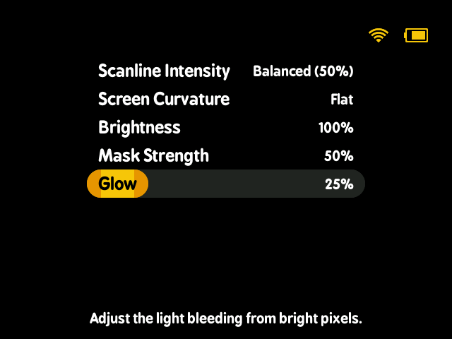

<div align="center">


**Cannelloni 1.0.0 — a focused retro gaming frontend for Linux handhelds.**

Built on [MinUI](https://github.com/shauninman/MinUI), inspired by [Cannoli](https://github.com/CannoliHQ/cannoli), with shaders from [Cannelloni for Android](https://github.com/Denarmo/cannelloni).

[](https://github.com/Denarmo/cannelloni-linux/releases/tag/v1.0.0)
[](#supported-devices)
[](#credits-and-licenses)

[Download 1.0.0](https://github.com/Denarmo/cannelloni-linux/releases/tag/v1.0.0) · [Installation guide](#install-with-the-desktop-installer) · [Shaders](#in-game-shaders) · [Report an issue](https://github.com/Denarmo/cannelloni-linux/issues)

</div>

## Your games, with a consistent menu

Cannelloni brings a simple game library, collections, recent games, save states, and a shared in-game menu to supported Linux handhelds. Choose an accent color, put your games in the supplied console folders, and launch them from the same interface.

Version **1.0.0** adds a desktop installer that reads its bundled OS archive, Nintendo DS launching through libretro by default, and a dedicated **Shaders** section in the in-game overlay. Release packages include freshly built launcher and emulator frontends for each target platform.

<p align="center">
  
  <br><sub>Current Linux shader menu, rendered from the application source on a desktop. Device status is fixture data; this is not a physical handheld capture.</sub>
</p>

<a id="installation"></a>

## Install with the desktop installer

### 1. Download and prepare your card

Download **[Cannelloni-Installer.zip](https://github.com/Denarmo/cannelloni-linux/releases/download/v1.0.0/Cannelloni-Installer.zip)** and extract it into a folder on your computer. Keep **`Cannelloni.zip` and `VERSION` beside the installer**. That ZIP is the OS payload: leave it compressed. Legacy payloads named `Cannoli.zip` are also recognized.

Use a FAT32 SD card prepared for your handheld. The installer copies files; it does not format the card or replace the device's underlying firmware. Back up an existing card first, especially `Saves` and `.userdata`, because installation replaces system files and applies fresh settings. See the [device notes](#supported-devices) for cards that also need a separate boot card.

### 2. Open the installer

| Computer | How to start |
| --- | --- |
| Windows | Double-click **`Cannelloni-Installer.exe`**. The packaged executable does not require Python. `Cannelloni-Installer.bat` also starts it. |
| Linux | Open a terminal in the extracted folder and run **`bash Cannelloni-Installer.sh`**. Requires Python 3. Install your distribution's Tkinter package for the native window, or use the local browser fallback. |
| Python source | Run **`python3 cannelloni_installer.py`**; add **`--web`** to open the local browser interface directly. |

<p align="center">
  
  <br><sub>The native Windows installer with Cannelloni Gold selected. It reads the bundled ZIP directly.</sub>
</p>

### 3. Choose your setup

Select the SD card's drive or mounted directory, choose your language and accent color, then select your handheld model. Check the selected destination before continuing. The preview helps you choose an accent; it is an illustration of the menu style.

The installer provides English, Spanish, French, Brazilian Portuguese, German, and Italian, with seven accent presets: Cannelloni Gold, Tomato Red, Basil Green, Sky Blue, Royal Purple, Carrot Orange, and Clean White.

<p align="center">
  
  <br><sub>The local browser fallback with Sky Blue and TrimUI Brick selected. Both interfaces use the same installation code.</sub>
</p>

### 4. Install and start playing

Click **Install Cannelloni to SD Card** and wait for the success message. Add your own games and any required BIOS files to the [folders below](#add-games-and-bios-files), safely eject the card, and insert it into the handheld. On two-card devices, complete the boot-card setup before powering on.

If the installer itself is run from the destination card's root, it preserves the consumed ZIP under a name ending in **`.zip.installed`** after a successful installation. This prevents a second installation at first boot. The installer can reuse that preserved archive later; archives stored on your computer keep their original names.

### Manual installation and updates

For a first installation without the desktop tool, download **`Cannelloni-1.0.0.zip`** from the [release page](https://github.com/Denarmo/cannelloni-linux/releases/tag/v1.0.0). Extract the **outer archive** to the card root, including hidden files. Leave the **inner `Cannelloni.zip`** compressed alongside the device boot files, then follow the appropriate device boot setup. A blank card containing only a ZIP is not sufficient for every device.

For an already working Cannelloni card, back up your data, then copy the **inner OS payload `Cannelloni.zip`** from the extracted release or installer package to the card root and boot the handheld. The downloadable release asset also named `Cannelloni.zip` is an alias of the outer release package; extract that outer package first to obtain the payload.

## Nintendo DS with the OS menu

Nintendo DS games now launch through **minarch and a libretro core**, giving them Cannelloni's in-game menu, save-state controls, display settings, and shaders. Modern toolchains build melonDS; older toolchains use DeSmuME2015. Game compatibility and speed depend on the core and handheld.

Place `.nds` games in **`Roms/Nintendo DS (NDS)/`** and any BIOS files required by your core in **`Bios/NDS/`**. The launcher reports missing cores or incomplete game transfers instead of silently switching to a standalone emulator.

Existing cards with the old packaged DraStic preference migrate to libretro. On Miyoo Mini devices with the standalone package installed, **Settings → Emulators** lets you explicitly select DraStic again. Standalone DraStic uses its own menu; its save states are not interchangeable with libretro states.

<p align="center">
  
  <br><sub>The current preset chooser, rendered from Linux application source on a desktop using fixture device status.</sub>
</p>

## In-game shaders

While playing through minarch, open **MENU → Shaders → Preset**. Choose a CRT or LCD treatment, then open **Parameters** to adjust the controls available for that preset. Resume the game to see the result.

| Style | Presets |
| --- | --- |
| CRT | CRT-Cannelloni, CRT-Cannelloni Lite, CRT-Easymode, CRT-Aperture, CRT-Geom, CRT-Lottes Fast, Zfast-CRT |
| LCD and pixels | LCD3x, Zfast-LCD, Dot Matrix |
| Simple filters | Scanlines, LCD Grid, Scanline Sine, Sharp Bilinear |
| Unfiltered | Off |

Depending on the preset, controls include **intensity, curvature, brightness, mask strength, and glow**. **Save for game** or **Save for console** saves all current emulator/frontend options at that scope, including shader settings. **Reset shaders** turns the effect off and restores its defaults. Launcher **Settings → Shaders** sets shared defaults; saved game and console choices take priority.

<p align="center">
  
  <br><sub>Current parameter controls, rendered from Linux application source on a desktop. Each preset exposes only the controls it uses.</sub>
</p>

These effects are **software adaptations** of the shaders from [Denarmo/cannelloni](https://github.com/Denarmo/cannelloni), rendered at display resolution on SDL1 and SDL2 devices. They do not execute GLSL on the GPU and are not pixel-identical to the Android shaders. Shaders start disabled. Full CRT and glow effects use more CPU; start with Lite or Zfast variants on slower devices. See the [shader notes](skeleton/SYSTEM/common/shaders/README.txt) for supported parameters, implementation differences, and attribution. Performance still needs validation on each handheld.

## More handheld features

- **Appearance and controls:** change accent color and language, select the device model, and swap A/B or X/Y from Settings. Accent changes preserve the current launcher and emulator frontends.
- **Save states and resume:** use the shared in-game menu to save and load states. Supported device power/sleep integration creates a quicksave for the next launch; follow your device's power-button behavior rather than cutting power during a write.
- **Collections and recent games:** browse recently played games or build text playlists in `Collections/` using paths to games on the card.
- **Disc games:** use `.m3u` playlists for multi-disc games and switch discs from the in-game menu where the core supports it.
- **Wi-Fi and Nonna's Kitchen:** on network-capable devices, connect to Wi-Fi, launch **Tools → Nonna's Kitchen**, and open **`http://<DEVICE_IP>:1091`** on a computer or phone on the same network to manage ROMs, BIOS files, saves, and states.

## Add games and BIOS files

The release creates console folders for you. Keep the **uppercase tag in parentheses** when renaming a ROM folder: `Game Boy Advance (GBA)` can become `My GBA Games (GBA)`. That tag chooses the emulator. BIOS folders use the tag alone, and BIOS filenames are case-sensitive.

```text
SD card/
├── Bios/
│   ├── GBA/                    # gba_bios.bin, where required
│   ├── NDS/                    # bios7.bin, bios9.bin, firmware.bin
│   └── PS/                     # psxonpsp660.bin
├── Roms/
│   ├── Game Boy (GB)/
│   ├── Game Boy Advance (GBA)/
│   ├── Nintendo DS (NDS)/
│   └── Sony PlayStation (PS)/
├── Collections/                # Text playlists of game paths
├── Saves/                      # In-game saves
├── .system/                    # Installed OS and emulator files
└── .userdata/                  # Settings, logs, and save states
```

The included emulator selection covers systems such as NES/Famicom, SNES/Super Famicom, Game Boy, Game Boy Color, Game Boy Advance, Mega Drive, PlayStation, and Nintendo DS. Available extra systems and core choices vary by platform. Use the console folders supplied in your release rather than assuming every core runs on every device.

## Supported devices

The release builds 12 platform targets. Boot requirements, Wi-Fi availability, emulator performance, and display behavior differ between devices.

| Family | Devices / platform targets | Installation notes |
| --- | --- | --- |
| Miyoo Mini | Mini and Mini Plus (`miyoomini`) | Use the matching model in the installer and retain the supplied Miyoo boot files. |
| Other Miyoo | A30 (`my282`), Flip (`my355`) | These have separate builds and boot files; do not select Mini as a substitute. |
| TrimUI | Smart (`trimuismart`), Smart Pro and Brick (`tg5040`) | Retain the supplied `trimui` boot directory and select the correct model. |
| Anbernic original | Original RG35XX (`rg35xx`) | Uses a different platform from H700 models. Follow its stock/boot-card requirements. |
| Anbernic H700 | RG35XX Plus/H/SP, RG28XX, RG CubeXX and related supported RG*XX models (`rg35xxplus`) | On two-card setups install the OS/data on TF2 and place the supplied matching `dmenu.bin` on TF1. |
| Powkiddy | RGB30 (`rgb30`) | Requires the device's compatible boot card; the data-card install is not a firmware image. |
| MagicX | XU Mini M (`magicmini`), Mini Zero 28 (`zero28`) | Separate platform builds; use the corresponding boot setup and data card. |
| GKD | Pixel (`gkdpixel`) | Retain its device boot files. |
| M17 | M17 (`m17`) | Retain `em_ui.sh`; use `+` or `−` as MENU. |

On RGB30, **L3 or R3** acts as MENU. Additional power, volume, and brightness shortcuts are documented in the [packaged user guide](skeleton/BASE/README.txt).

## Building and contributing

Run the host checks with **`python -m unittest discover -s tests -v`**. They cover ZIP installation, DS launch routing, shader rendering and settings, and release contents. Host checks do not replace testing on a handheld.

For local frontend builds, use Docker, a POSIX shell, and make on a host that matches the toolchain architecture, then run **`sh scripts/build_release_frontends.sh <platform>`**. The `magicmini`, `my355`, `zero28`, and `tg5040` toolchain images require an ARM64 Docker host; the remaining targets use an x86-64 host. The [release workflow](.github/workflows/release.yml) uses both runner architectures and is the recommended way to build the full matrix. The build selects melonDS when the cross compiler supports C++17 and DeSmuME2015 otherwise.

Build **`dist/Cannelloni-Installer.exe`** using PyInstaller on Windows, then run **`python scripts/create_release_archives.py`** with all required platform artifacts available. Packaging requires freshly built launcher/minarch binaries and a matching DS core for each platform; it rejects missing builds or incorrect core architectures. **`python scripts/verify_release_archive.py releases/Cannelloni-Installer.zip --built-workspace workspace`** verifies the packaged payload against those builds.

The [release workflow](.github/workflows/release.yml) performs the tests, platform builds, Windows installer build, packaging, and archive verification before publishing. Releases use semantic versions such as **1.0.0**, with the Git tag **`v1.0.0`**.

For a targeted CI check, choose one platform when manually running the workflow. Single-platform runs upload build artifacts but skip tagging and publication; select **all** to build and publish a complete release.

## Credits and licenses

Thank you to [Shaun Inman and MinUI contributors](https://github.com/shauninman/MinUI), [CannoliHQ](https://github.com/CannoliHQ/cannoli), [Libretro](https://www.libretro.com), the emulator and shader authors, and the handheld developers whose toolchains and platform work make this project possible. Additional platform attributions are in the [packaged guide](skeleton/BASE/README.txt).

Cannelloni combines components with different licenses. Upstream code, emulator cores, libraries, and shaders retain their notices and terms. The combined software shader adaptations are GPL-3.0-or-later; see the [shader attribution and license notes](skeleton/SYSTEM/common/shaders/README.txt), [LICENSE](LICENSE), and [LEGAL.md](LEGAL.md).

No game ROMs or BIOS files are included. Cannelloni is an independent community project; product names and trademarks belong to their respective owners.

For support and feature requests, use [GitHub Issues](https://github.com/Denarmo/cannelloni-linux/issues). You can also contact **`@denarmo`** on Discord.
